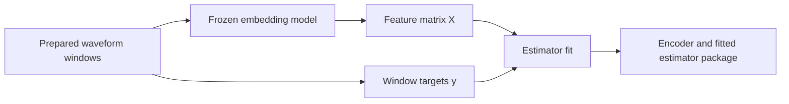

# Batch training with frozen features

Some classifiers learn from a complete feature matrix instead of minimizing a neural-network loss one minibatch at a time. DRIVEN is one example: first train its neural branches, then freeze them and fit a LightGBM classifier on their outputs. The second stage needs the selected neural weights and the same signal preparation, but it has no optimizer, epochs or backpropagation.

`BatchTrainer` implements that second stage. It consumes the ordinary training and validation loaders, asks an embedding model for one feature vector per valid window, and calls the estimator's `fit` once. It is independent of the gradient `BaseTrainer`. The normal runner still handles configuration, logging, testing and package export.

## From recordings to a fitted classifier



Dataset preparation is unchanged: select patient paths, initialize the dataset, and load waveform windows with their prepared targets. The embedding model's `features(data)` applies its tensor preprocessing once and returns `[B,D]`, where D is fixed. The trainer keeps features and targets in the supplied loader order, removing the same invalid rows from both.

Training and validation are extracted separately. Only training data can warm feature preprocessing or define the estimator's training bins and trees. Validation is passed to `fit(..., validation_data=(X_val, y_val))` for early stopping or selection; no validation loader passes `None`. An explicitly supplied loader with no usable targets is an error. Test data is used after fitting.

`BatchClassifierModel` owns both the frozen encoder and estimator from construction. `BatchTrainer.fit(model, train_loader, val_loader)` fits that estimator in place and returns training metadata, like the gradient trainers. There is one `RunCfg.model` and no separate run-level encoder. Unfitted construction is allowed; prediction and export require fitting. At inference it converts raw model inputs to features, obtains class probabilities, and returns `[B,1,C]` log-probabilities in the declared class order. The ordinary prediction formatter applies softmax. A final package needs neither its source neural package nor the extracted feature files.

## A complete Python example

This small example uses flattened two-sample windows to demonstrate the interfaces. For a learned representation, replace `encoder` with `load_embedding_model("models/selected-neural-model")`; the remainder is the same.

```python
import torch

from sleepwalker.models.PreprocessorEmbeddingModel import PreprocessorEmbeddingModel
from sleepwalker.models.BatchClassifierModel import BatchClassifierModel
from sleepwalker.models.batch.LightGBMModel import LightGBMModel
from sleepwalker.trainer.BatchTrainer import BatchTrainer

classes = ["regular", "event"]
encoder = PreprocessorEmbeddingModel(
    ts_len=2, n_channels=1, embedding_dim=2,
    preprocessors=[torch.nn.Flatten(start_dim=1)],
)
x = torch.tensor([-3., -2., -1., 1., 2., 3.]).reshape(6, 1, 1).repeat(1, 2, 1)
y = torch.nn.functional.one_hot((x[:, 0, 0] > 0).long(), 2).float()
training = [{"data": x, "target": y[:, None, :]}]

estimator = LightGBMModel(
    classes, num_boost_round=10, early_stopping_rounds=0,
    parameters={"min_data_in_leaf": 1, "num_leaves": 3, "num_threads": 1},
)
trainer = BatchTrainer(classes, target_resolution="1s")
model = BatchClassifierModel(encoder, estimator, classes)
result = trainer.fit(model, training)
probabilities = model(x).softmax(dim=-1)  # [6,1,2], in classes order
```

The target adapter accepts hard one-hot `[B,C]` or `[B,1,C]` targets. An optional `[B]` or `[B,1]` `target_mask` excludes complete rows. Without a mask, all-zero targets are invalid rows. Temporal sequences, soft targets and sample weights need another explicit target/backend contract; they are rejected here.

## Reusing and fitting preprocessing

`prepare_features="reuse"` is the default. It preserves the encoder's saved preprocessing, which is the correct choice for a selected neural package. The caller supplies a ready-to-use encoder; the trainer does not add a separate fitted-state protocol to preprocessors.

Use `prepare_features="fit"` when constructing a new preprocessing-only feature model whose stateful steps still need training statistics. The trainer calls the existing warmup/update interfaces on a nonpersistent warmup loader over the supplied training population, in pipeline order. Data loading keeps the configured worker count; the encoder owns its statistics in the main process/device. Each pass finishes before extraction starts its workers. It then freezes the encoder and extracts both splits in evaluation mode without gradients. Never refit the selected encoder on validation or test data. Recording-fit channel processors retain their normal per-recording inference behavior; they are distinct from tensor preprocessing inside the encoder.

## Using the ordinary CLI

Train and export the selected neural model first. In a second ordinary training configuration, declare its package as the feature model:

```yaml
model:
  name: sleepwalker.models.BatchClassifierModel.BatchClassifierModel
  classes: &classes [regular, event]
  embedding_model:
    name: sleepwalker.deployment.load_embedding_model
    package: models/selected-neural-model
  batch_model:
    name: sleepwalker.models.batch.LightGBMModel.LightGBMModel
    classes: *classes
    num_boost_round: 500
    early_stopping_rounds: 35
    parameters:
      num_threads: 8
      max_bin: 63
trainer:
  name: sleepwalker.trainer.BatchTrainer.BatchTrainer
  classes: [regular, event]
  target_resolution: 30s
run:
  package_path: models/fitted-classifier
  expert_task: breathing
```

This fragment supplies the second-stage components; it still needs ordinary `data` entries with patient splits, signal preparation and binary targets. Run it with `sleepwalker train train-batch.yml`. Do not configure optimizer/scheduler/epochs for `BatchTrainer`. The full [DRIVEN recipes](https://github.com/sleepwalker-team/models/tree/main/literature/osa/driven) provide both stages and their cohort settings.

The runner defaults batch training to sequential, unbalanced extraction without dropping short batches. Set `run.n_samples`, `run.n_samples_validation` and the sampling policies explicitly when selecting a smaller population. `random` with a sample budget below the population size draws a seeded candidate subset without replacement on each pass, with bookkeeping proportional to the budget. It uses the same sampling option as ordinary training; rejected candidates are not replenished. These choices affect the experiment, independently of where features are stored.

## Memory, files and continuation

RAM is the default. Extraction preallocates float32 features and int64 targets when the loader declares its length; otherwise it concatenates batch arrays at the end. Raw storage costs approximately `N * (4 * D + 8)` bytes, excluding estimator allocations.

For disk extraction, add:

```yaml
trainer:
  name: sleepwalker.trainer.BatchTrainer.BatchTrainer
  classes: [regular, event]
  target_resolution: 30s
  store_on_disk: true
  feature_path: results/features/selected-neural-model
```

The trainer writes `train-features.bin`, `train-targets.bin` and corresponding validation files, then opens memmaps with the actual accepted row counts. Each extraction overwrites its own files. There is no persistent feature cache, row hashing or partial-extraction replay. Use a separate directory for concurrent runs.

The native checkpoint at `<log_path>/<experiment_name>/batch/checkpoint.pt` saves the prepared encoder and estimator before extraction and after fitting. `sleepwalker resume` restarts an interrupted extraction/fit; a completed fit is reused. Raw feature arrays are never embedded in the checkpoint. The normal package exporter serializes the complete fitted classifier for inference.

Disk extraction saves the raw RAM matrix, but LightGBM still allocates bins, labels, gradients and histograms. Its memmap adapter casts bounded construction batches to float64. Training defines the bins; validation uses the training reference. A histogram-cache setting is only one part of memory use. Choose row caps and feature dimensions explicitly; the trainer never reduces the population automatically or fits changing patient chunks as though they were a full fit.
