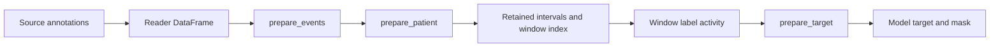

# Annotation events and dataset preparation

Sleep databases describe the same physiology in different formats: XML event names, stage-change markers, spreadsheets, or text sidecars. Readers translate these sources into ordinary DataFrames with labels and absolute start/end times. A training task then decides what those events mean for its targets. For example, sleep staging keeps the stage labels, while arousal detection may combine all sleep stages into a `sleep` mask and predict only `no_arousal`/`arousal`.

Keeping those two operations separate lets a task use the same preparation code across datasets. The reader decodes source names and measurements. The configured callback performs task choices such as mapping, merging, wake exclusion or hypopnea association. No source file is reread when sampling a window.

## The data flow



The dataset is configured with a patient list and prepares each recording once during `initialize(patients)`. It validates reader output against `supported_events()`, applies `prepare_events`, validates the result against `annotation_labels`, and projects the temporal core for subsequent patient/window processing. After `prepare_patient`, it builds recording bounds and window offsets from the retained intervals. Window access samples label activity and calls `prepare_target`; `prepare_sample` assembles the final tensors.

| Hook | When and input | Purpose and output |
| --- | --- | --- |
| `prepare_events` | Once per recording, complete primary/alternate event DataFrames, including optional source metadata. | Task event transformation; return the two prepared tables or `None` to reject the recording. |
| `prepare_patient` | Once per recording, task-labelled temporal tables and patient path. | Trim or reject the recording before indexing windows. |
| `prepare_target` | Per candidate window, sampled label activity and timestamps. | Construct the output target/mask or reject the window. |
| `prepare_sample` | Per accepted window, signal and prepared target payload. | Assemble the tensor sample returned to the loader. |

Use `training.callbacks` for common preparation. `map_events` handles a mapping dictionary; `prepare_sleep_events` additionally composes interval merging and wake exclusion. `prepare_patient_events` combines optional duration filtering and trimming. Target builders live in `trainer.utils.targets`, because they determine the model supervision. Method-specific annotation policies live with their recipe, such as `models.DRIVEN.prepare_events`.

## Three label declarations with different jobs

Consider an arousal model trained only on sleep:

| Declaration | Example | Meaning |
| --- | --- | --- |
| `reader.supported_events()` | `wake, n1, n2, n3, rem, arousal, ...` | Physiological event types this reader can decode, before task preparation. |
| `annotation_labels` | `[sleep, arousal]` | Allowed prepared annotation columns, including labels used only for masks. |
| `output_classes` | `[no_arousal, arousal]` | Model/target class order in the training configuration. |

The model does not predict the `sleep` mask. Conversely, `no_arousal` needs no negative event intervals: the target builder can use it as the unique missing class when a valid sleep window has no positive arousal coverage. Declare both vocabularies explicitly; callback inspection and the observed labels of one patient cannot determine model dimensions reliably. An absent declared event still has a zero activity column. `dataset.observed_labels` separately records what actually occurred.

## Configure an event preparation callback

This training-config fragment maps source sleep stages to a mask while preserving arousal events. Channel settings and patient splits are omitted; see [Load and prepare data](../how-to/data.md) for a complete dataset setup.

```yaml
data:
  annotation_labels: [sleep, arousal]
  output_classes: [no_arousal, arousal]
  prepare_events:
    name: sleepwalker.training.callbacks.map_events
    mapping:
      n1: sleep
      n2: sleep
      n3: sleep
      rem: sleep
      arousal: arousal
  prepare_target:
    name: sleepwalker.trainer.utils.targets.prepare_multiclass_target
    target_classes: [no_arousal, arousal]
    target_resolution: 30s
    filters:
      - columns: [sleep]
        percentage: 1.0
        mode: min
```

`prepare_events` defines the available task intervals; `prepare_target` decides which windows are valid and assigns their output class. The positive overlap threshold is a separate target setting. Keeping it explicit matters when two recipes use the same events but different window definitions.

For Python callers, bind an ordinary function with the shared callback signature:

```python
def prepare_events(label_df, label_extra_df):
    def transform(events):
        result = events.copy()
        result.loc[result["Label"].isin(["n1", "n2", "n3", "rem"]), "Label"] = "sleep"
        return result.loc[result["Label"].isin(["sleep", "arousal"])].copy()

    primary = transform(label_df)
    alternate = None if label_extra_df is None else transform(label_extra_df)
    return primary, alternate
```

Pass it as the dataset's `prepare_events` argument. Each annotator is transformed independently using its own evidence. `None` as the callback means identity transformation. Returning `None` from a configured callback rejects the recording; an empty prepared primary also excludes it. An unavailable alternate remains `None`, and an available empty alternate remains an empty DataFrame. Exceptions and invalid schemas are processing errors.

## Measurements and method-specific rules

Optional metadata is available to `prepare_events` before core projection. DRIVEN uses `desaturation_drop_pp` to associate hypopneas with at least a 3 percentage-point desaturation or a nearby arousal. Its latest-pending matching rule, unknown-evidence handling, and mapping are together in `models.DRIVEN`; this is a DRIVEN protocol choice, not an implicit reader behavior. See the [DRIVEN source and recipe](https://github.com/sleepwalker-team/models/tree/main/literature/osa/driven).

DRIVEN's `models.DRIVEN.prepare_target` callback checks sleep coverage and unknown hypopneas over the first 30 seconds, before delegating to the generic multitask builder. The final 25 seconds supplies future SpO2 context. These method-specific eligibility rules are not fields in the generic multitask configuration.

A reader's support for `desaturation` does not guarantee amplitude measurements. A recipe must distinguish a missing measurement column from an unavailable individual value. DRIVEN can error or reject a recording when the column is absent; missing values within a present column can leave hypopneas unknown and masked. Never infer a drop from source-label text in the task callback or substitute zero.

A supported event type with no rows is an empty observed event set; it does not prove that the source scored that type. `supported_events()` describes reader capability, independently of patient selection. ISRUC exposes primary and alternate annotations independently by default; its historical reader intersection remains the explicit `merge=True` option.

For raw inference, `load_annotations=False` skips annotation readers and hooks and rejects labelled callback/vocabulary settings. `UnlabelledDataset.from_dataset(...)` copies the signal pipeline while omitting annotation handling. An inference package can therefore predict a recording without training labels.

## Temporal core

Each row represents one event on the recording clock. `Label`, `Starttime` and `Endtime` are required, including on empty tables. Timestamps must have pandas datetime dtypes, no missing values, matching timezones and `Endtime > Starttime`. Intervals are half-open: `Starttime <= t < Endtime`. Readers decode source offsets, rollovers and change markers before returning this table. Overlapping and duplicate intervals are allowed; row order/index has no semantic meaning.

`validate_event_table(events, allowed_labels=..., context=...)` checks the core and an optional declared vocabulary. It never drops rows because optional metadata is missing. `validate_event_labels(...)` preserves declared order and rejects duplicates/empty strings. These checks do not infer which concepts were scored or which measurements a reader can provide.

## Recognized event names

| Name | Meaning |
| --- | --- |
| `wake` | Scored wakefulness. |
| `n1`, `n2`, `n3`, `rem` | Scored sleep stages. Source stage 4 belongs to n3 where the source convention supports that conversion. |
| `unscored` | An explicit unscored interval; never an implicit negative event. |
| `arousal` | Annotated arousal. |
| `obstructive_apnea`, `central_apnea`, `mixed_apnea` | Apnea with an explicit source subtype. |
| `apnea` | Apnea whose subtype is unspecified. |
| `hypopnea` | Annotated hypopnea before association or task relabeling. |
| `desaturation` | Annotated oxygen desaturation; does not imply measured amplitude is available. |
| `limb_movement` | Annotated limb movement. |
| `periodic_limb_movement` | Source explicitly identifies periodic limb movements. |
| `movement` | A general movement annotation or movement-coded stage; no limb specificity is inferred. |
| `rera` | Source explicitly identifies a respiratory effort-related arousal. |
| `periodic_breathing`, `cheyne_stokes` | Explicit source respiratory patterns, retained as distinct concepts. |
| `respiratory_artifact`, `spo2_artifact` | Source-annotated respiratory/oximetry artifacts. |
| `body_position_left`, `body_position_right`, `body_position_supine`, `body_position_prone`, `body_position_upright` | Explicit body-position intervals, expanded from change markers under the source convention when necessary. |
| `device_settings` | An explicit device-settings annotation; its absence does not establish non-use of a device. |
| `other` | An unclassified source event. Preserve its original source text for investigation. |

A reader can document additional source concepts without guessing physiology. Task labels such as `sleep`, `respiratory_event` and `hypopnea_unknown` belong to the transformed annotation vocabulary, not necessarily the reader's capabilities. Model output classes are separately declared; an implicit negative can be an output class without an annotation interval.

## Optional field catalogue

| Field | Type and units | Meaning and applicable events | Missing-value behavior |
| --- | --- | --- | --- |
| `desaturation_drop_pp` | Nullable numeric scalar, percentage points. | Measured SpO2 drop for `desaturation`. A fall from 96% to 92% is 4.0. | Omit the column when a recording's source cannot supply measurements; individual unavailable/irrelevant values are missing. Never fabricate zeros. |
| `SourceLabel` | Nullable string scalar, no unit. | Original source text for any event, retained for diagnostics/provenance. | Missing when unavailable. Shared physiological algorithms must not parse it. |

Consumers validate the optional fields they need and distinguish an absent column from a missing per-event value. Readers perform source-unit conversion and cheap extraction during annotation parsing. Waveform-derived measurements require an explicit processing operation. Add future fields here with type, units, meaning, applicable events and missing-value behavior. Duration is derived from the temporal core.

## Mapping and sleep policies

`sleepwalker.training.callbacks.map_events(label_df, label_extra_df, *, mapping, remove_unmapped=True)` applies the same dictionary to both available annotators independently. It is also exported through `sleepwalker.datasets.utils.map_events` for configuration use. It preserves metadata and returns independent tables. With `remove_unmapped=False`, unmatched labels retain their meaning. An unavailable alternate remains `None`; an empty available alternate remains an empty table. Mapping neither creates fallback intervals nor discovers class order.

`merge_event_intervals(events, labels=...)` unions overlapping intervals for each selected label. Touching endpoints remain separate by default. Optional scalar metadata survives only when all contributing rows agree, including missingness; conflicting values become missing rather than inheriting an arbitrary measurement. The result retains unselected events individually and sorts chronologically. Merged duration is always derived from the resulting endpoints.

`exclude_events_on_wake(events, labels=...)` removes entire selected events that overlap `wake`. An empty wake set removes nothing. `touching_counts_as_overlap=True` explicitly enables Ruhrland's historical endpoint policy in both helpers.

`sleepwalker.training.callbacks.prepare_sleep_events(...)` composes merging, wake exclusion and mapping in that order, separately for each annotator. Its parameters are `mapping`, `merge_labels`, `exclude_on_wake`, `touching_counts_as_overlap` and `remove_unmapped`. Ruhrland recipes configure these policies explicitly instead of applying them inside the spreadsheet reader. Both primary and alternate annotators now undergo the configured sequence; historical primary-only Ruhrland preprocessing is therefore a protocol difference.

SHHS/MrOS/ABC and the other NSRR/Profusion readers expose common physiological concepts and retain original labels. NSRR baseline/nadir and Profusion drop fields follow the [NSRR translator's documented meanings](https://github.com/nsrr/edf-editor-translator/wiki/Tutorial-2-EDF-Annotation-Translator), with drops expressed in percentage points. HSP extracts explicit `drop ... %` measurements before task mapping. Missing columns remain absent; missing measurements within present columns remain nullable. Unbounded HSP stage changes and instantaneous markers do not become invented intervals.

## Retained intervals

`EventIndex.events` retains an independent copy of the fully prepared DataFrame supplied to its constructor, preserving individual intervals, overlaps, duplicates, metadata, row order/index, datetime precision and timezone. Changing the caller's input table afterward does not change the retained table or target sampling. Treat the retained table as read-only and use `index.events.copy()` before modifying it for analysis, because the sampling arrays were built from it during construction. The selected recording bounds are on its containing `EDFFile.start_date` / `end_date`; clipping to prediction coverage belongs to the evaluator. Access neither rereads raw annotations nor repeats preparation callbacks.

The annotation contract itself is an ordinary DataFrame with the agreed labels and timestamps. `get_event_df()` decodes source annotations; mapping/filtering/trimming then produces the fully prepared DataFrame passed to `EventIndex`. The index stores that table directly alongside paired endpoint arrays for sampling many windows. There is no conversion method or interval reconstruction step.
